# 🚗 DriveGo — Sistema de Gestão de Locadora de Veículos

O **DriveGo** é uma aplicação web desenvolvida para auxiliar no gerenciamento de uma locadora de veículos, centralizando operações de cadastro, controle de clientes, veículos e locações em uma única plataforma.

O projeto foi desenvolvido como parte de um trabalho acadêmico, utilizando tecnologias de desenvolvimento web, banco de dados relacional, autenticação de usuários, testes automatizados e hospedagem em nuvem.

---

## 📸 Apresentação do projeto

### Organização e planejamento — Trello

O Trello foi utilizado para organizar as atividades do grupo, acompanhar o desenvolvimento e registrar as contribuições dos integrantes.

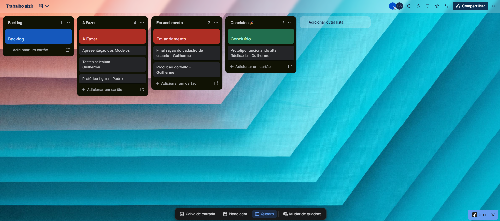

### Protótipos — Figma

O Figma foi utilizado para elaborar os protótipos das interfaces, permitindo visualizar a estrutura e a navegação do sistema antes e durante sua implementação.

**Tela de login**

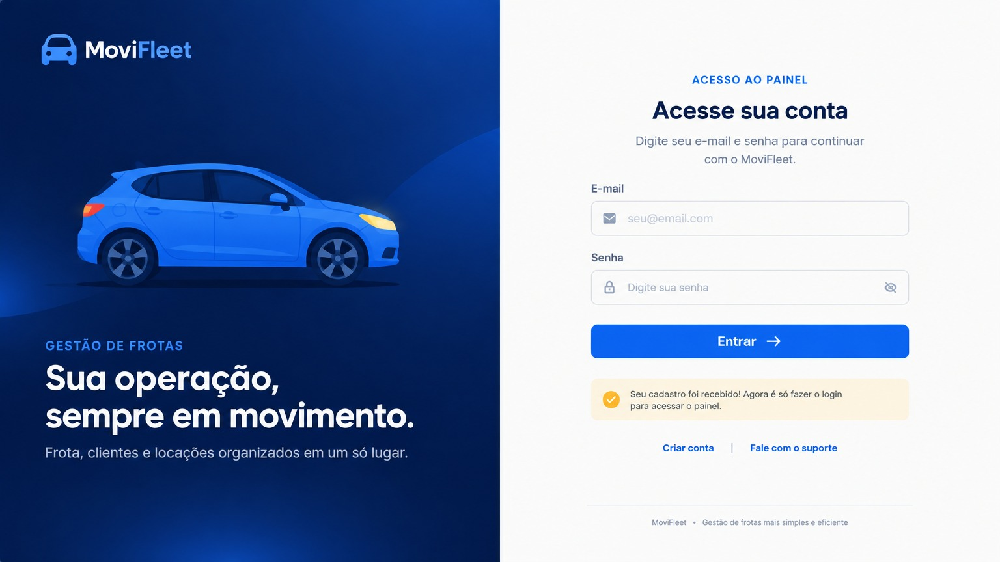

**Visão geral do sistema**

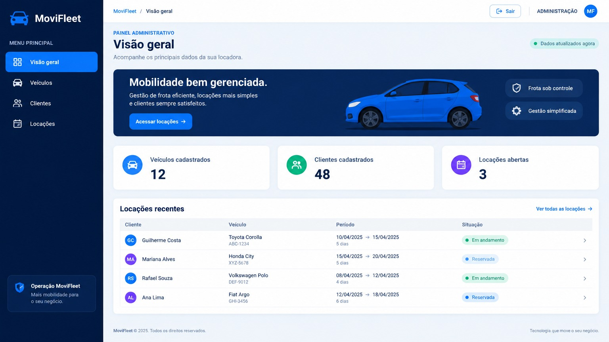

**Gerenciamento de veículos**

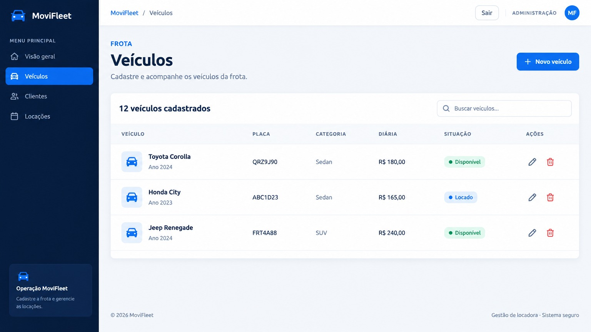

**Gerenciamento de clientes**

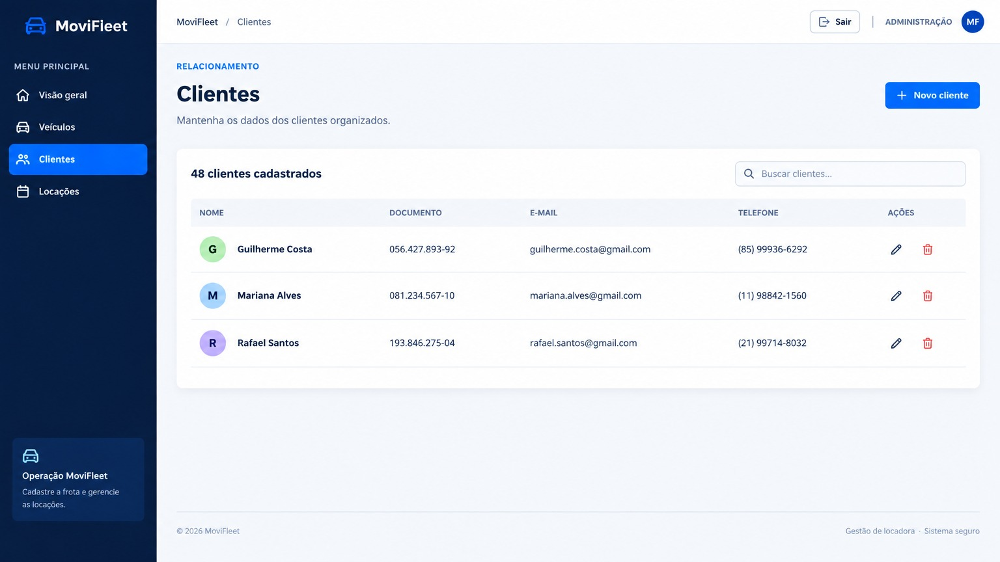

**Gerenciamento de locações**

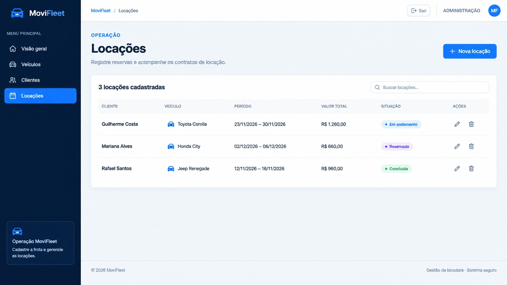

---

## ⚙️ Funcionalidades

- **Autenticação:** acesso ao sistema por meio de e-mail e senha.
- **Cadastro de usuários:** criação de novas contas.
- **Aprovação administrativa:** novos usuários precisam ser aprovados pelo administrador antes de acessar o sistema.
- **Gerenciamento de veículos:** cadastro e controle dos veículos da locadora.
- **Gerenciamento de clientes:** registro e consulta dos clientes.
- **Gerenciamento de locações:** controle das operações de locação.
- **Controle de acesso:** proteção das páginas internas e das funcionalidades administrativas.

---

## 💻 Tecnologias utilizadas

| Tecnologia | Aplicação |
|---|---|
| HTML5 | Estrutura das páginas |
| CSS3 | Estilização das interfaces |
| JavaScript | Funcionalidades do front-end |
| Node.js | Ambiente de execução |
| Express.js | Servidor e rotas da aplicação |
| SQLite | Banco de dados relacional |
| Selenium WebDriver | Automação de testes |
| Git e GitHub | Versionamento e colaboração |
| Microsoft Azure | Hospedagem da aplicação |
| Figma | Prototipação das interfaces |
| Trello | Organização das atividades |

---

## 🏗️ Desenvolvimento

### Ambiente de desenvolvimento — VS Code

O desenvolvimento da aplicação foi realizado utilizando o Visual Studio Code, com organização do código em arquivos e diretórios responsáveis pelo servidor, autenticação, páginas e funcionalidades do sistema.

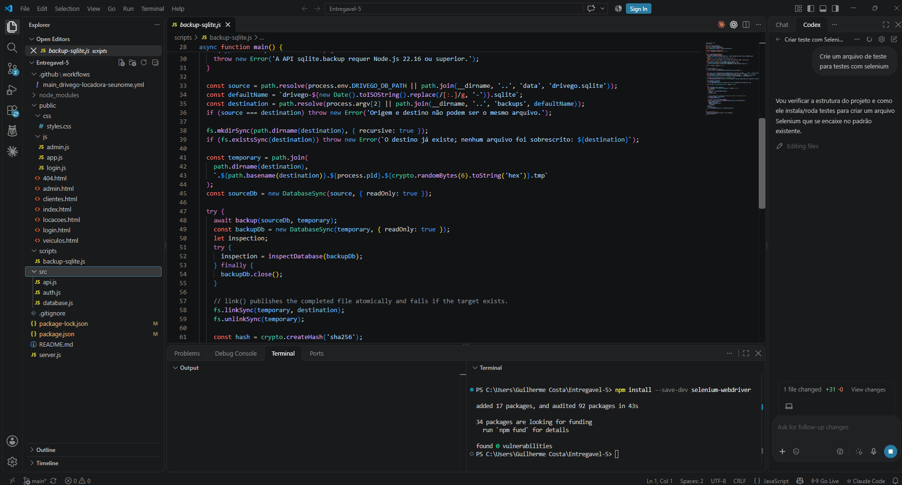

### Banco de dados — SQLite

O sistema utiliza SQLite para armazenar as informações da aplicação.

O banco possui tabelas responsáveis pelo gerenciamento dos veículos, clientes, locações e usuários.

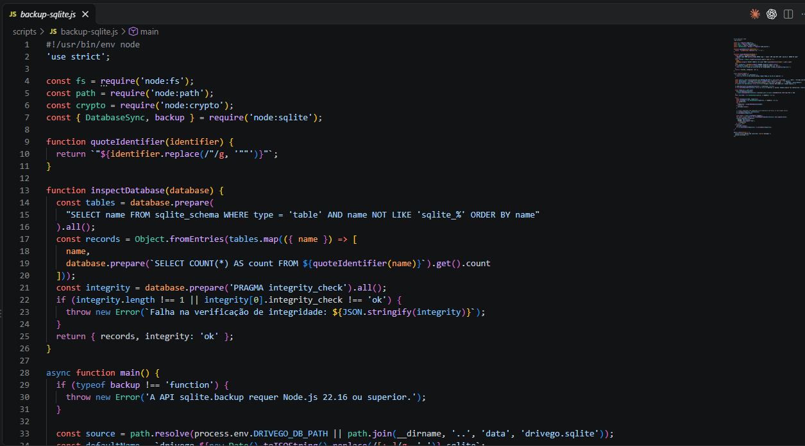

**Estrutura das tabelas:**

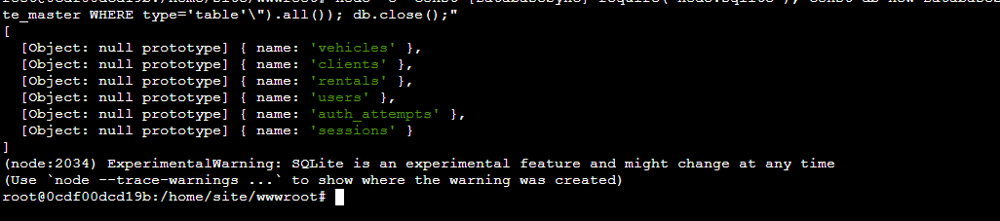

Na implantação em nuvem, o banco foi configurado para utilizar armazenamento persistente no ambiente da Azure.

---

## 🧪 Testes automatizados — Selenium

Foram utilizados testes automatizados com Selenium WebDriver para verificar o comportamento das páginas e os mecanismos de proteção de acesso.

### Estrutura dos testes

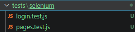

### Execução dos testes

Entre as verificações realizadas estão:

- Abertura da tela de login.
- Redirecionamento de visitantes não autenticados.
- Proteção das páginas de veículos, clientes e locações.
- Verificação do acesso à página administrativa, quando configuradas as credenciais de teste.

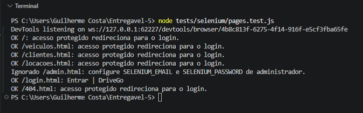

---

## ☁️ Implantação na Microsoft Azure

O DriveGo foi publicado utilizando o serviço **Azure App Service**, permitindo disponibilizar a aplicação pela internet.

**Endereço da aplicação:**

[https://drivego-locadora-seunome-bxdsdqbqdadgcuay.brazilsouth-01.azurewebsites.net/](https://drivego-locadora-seunome-bxdsdqbqdadgcuay.brazilsouth-01.azurewebsites.net/)

A aplicação utiliza Node.js no ambiente de hospedagem e SQLite com armazenamento persistente para conservar os dados.

---

## ▶️ Como executar o projeto localmente

### Pré-requisitos

- Node.js instalado.
- Git instalado.
- Navegador Google Chrome (para os testes Selenium).

### 1. Clonar o repositório

```bash
git clone https://github.com/costinha1510/Entregavel-5.git
```

### 2. Acessar a pasta

```bash
cd Entregavel-5
```

### 3. Instalar as dependências

```bash
npm install
```

### 4. Configurar as variáveis de ambiente

Configure as seguintes variáveis antes de iniciar a aplicação:

```text
SESSION_SECRET
ADMIN_EMAIL
ADMIN_PASSWORD
ADMIN_NAME
```

Essas variáveis são utilizadas para configurar a segurança das sessões e a conta inicial do administrador.

**Importante:** não compartilhe credenciais nem envie arquivos com segredos para o GitHub.

### 5. Iniciar o servidor

```bash
npm start
```

A aplicação ficará disponível em:

```text
http://localhost:3000
```

### 6. Executar os testes Selenium

Com o servidor em execução, abra outro terminal e execute:

```bash
node tests/selenium/pages.test.js
```

Para os testes que exigem autenticação administrativa, configure também:

```text
SELENIUM_EMAIL
SELENIUM_PASSWORD
```

---

## 🎯 Objetivo acadêmico

O desenvolvimento do DriveGo teve como objetivo aplicar conhecimentos de desenvolvimento de sistemas, integração entre front-end e back-end, persistência de dados, autenticação, controle de acesso, testes automatizados, versionamento de código e implantação de aplicações em nuvem.

O projeto também proporcionou a experiência de trabalhar em equipe, organizar tarefas e documentar as etapas de desenvolvimento.

---

## 👥 Equipe de desenvolvimento

Projeto acadêmico desenvolvido em grupo.

As atividades e contribuições individuais podem ser consultadas no registro de organização do projeto no Trello.

---

**DriveGo — Gestão de locações de veículos em um só lugar.** 🚗
