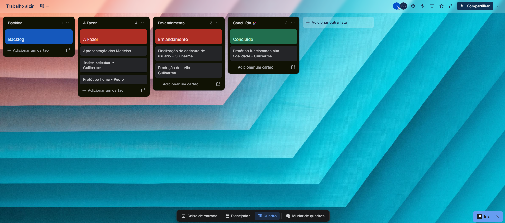
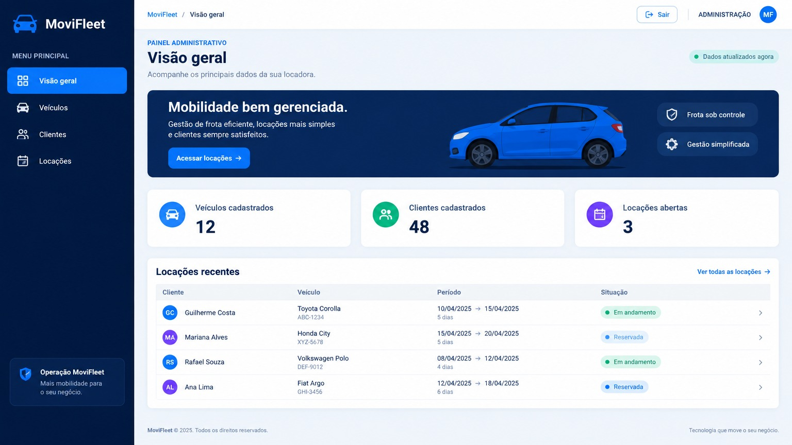
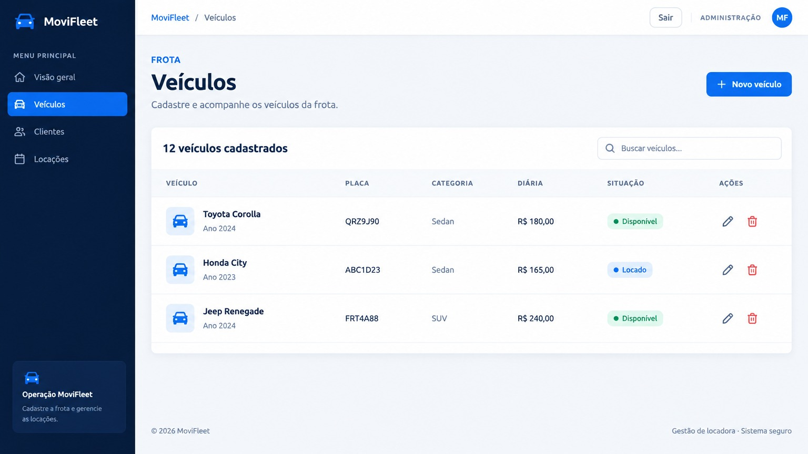
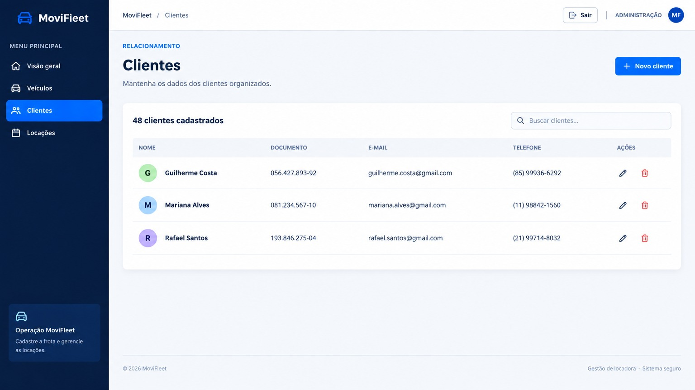
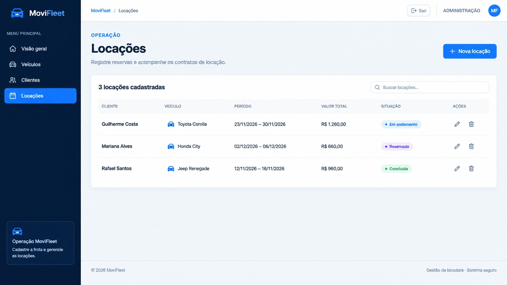
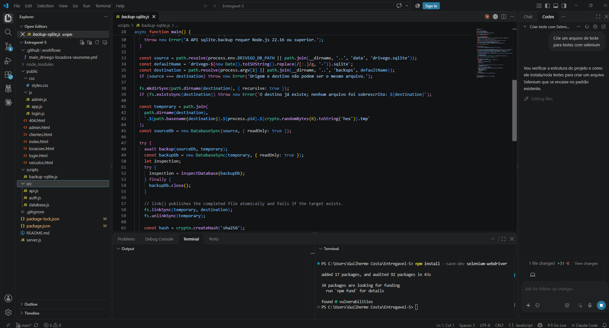
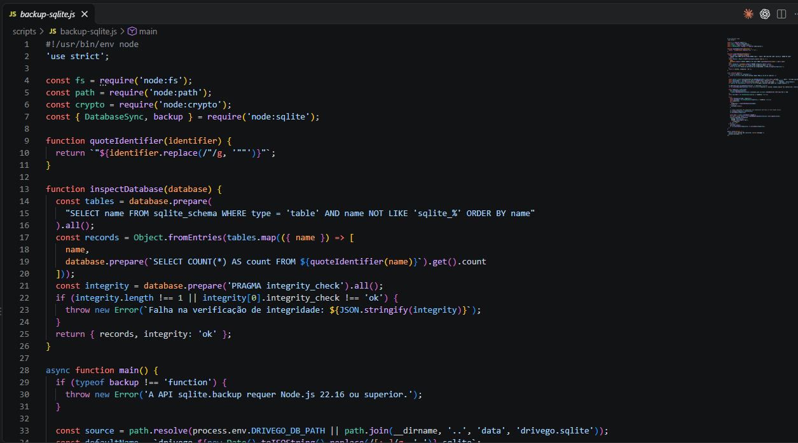
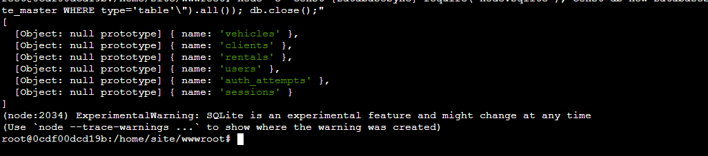
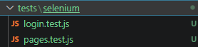
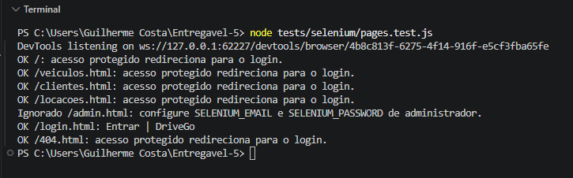

# 🚗 DriveGo — Sistema de Gestão de Locadora de Veículos

O **DriveGo** é uma aplicação web desenvolvida para facilitar o gerenciamento de uma locadora de veículos. O sistema permite organizar veículos, clientes e locações em uma interface intuitiva, moderna e de fácil utilização.

A aplicação está publicada na nuvem por meio do **Microsoft Azure**, permitindo seu acesso pela internet.

<p align="center">
  <a href="https://drivego-locadora-seunome-bxdsdqbqdadgcuay.brazilsouth-01.azurewebsites.net/">
    <strong>🌐 ACESSAR DRIVEGO ONLINE</strong>
  </a>
</p>

---

## 📑 Sumário

- [Demonstração](#-demonstração)
- [Funcionalidades](#-funcionalidades)
- [Tecnologias utilizadas](#️-tecnologias-utilizadas)
- [Hospedagem e implantação](#️-hospedagem-e-implantação)
- [Como executar o projeto localmente](#-como-executar-o-projeto-localmente)
- [Estrutura do projeto](#-estrutura-do-projeto)
- [Ambientes de desenvolvimento utilizados](#-ambientes-de-desenvolvimento-utilizados)
- [Objetivo do projeto](#-objetivo-do-projeto)
- [Desenvolvedor](#-desenvolvedor)

---

## 📌 Demonstração

**Aplicação em produção:**  
https://drivego-locadora-seunome-bxdsdqbqdadgcuay.brazilsouth-01.azurewebsites.net/

**Repositório GitHub:**  
https://github.com/costinha1510/Entregavel-5

---

## ✨ Funcionalidades

O DriveGo oferece funcionalidades para o gerenciamento das principais operações de uma locadora:

- 🚘 **Gerenciamento de veículos:** cadastro e organização dos veículos disponíveis.
- 👥 **Gerenciamento de clientes:** registro e consulta de informações dos clientes.
- 📋 **Gerenciamento de locações:** controle dos registros de locação.
- 📊 **Painel de controle:** interface para acompanhar e administrar as informações do sistema.
- 💾 **Armazenamento de dados:** utilização do banco de dados SQLite.
- ☁️ **Hospedagem em nuvem:** aplicação disponível publicamente por meio do Microsoft Azure.

---

## 🛠️ Tecnologias utilizadas

| Tecnologia | Finalidade |
|---|---|
| HTML5 | Estrutura da aplicação |
| CSS3 | Estilização e layout |
| JavaScript | Interatividade e funcionalidades |
| Node.js | Ambiente de execução do servidor |
| Express.js | Desenvolvimento do backend e rotas |
| SQLite | Banco de dados relacional |
| Selenium WebDriver | Testes automatizados de interface |
| Git e GitHub | Versionamento e armazenamento do código |
| GitHub Actions | Automação da implantação |
| Microsoft Azure | Hospedagem da aplicação |

---

## ☁️ Hospedagem e implantação

O projeto foi publicado utilizando o **Microsoft Azure App Service**, com ambiente Linux e runtime Node.js 22 LTS.

A implantação foi configurada por meio do **GitHub Actions**, permitindo automatizar o processo de publicação.

### Fluxo de implantação

1. O código-fonte é enviado para o repositório GitHub.
2. O GitHub Actions identifica as alterações na branch `main`.
3. O fluxo de trabalho instala as dependências e prepara a aplicação.
4. O projeto é enviado automaticamente para o Azure App Service.
5. A aplicação fica disponível por meio de seu endereço público.

---

## 💻 Como executar o projeto localmente

### Configuração de autenticação

O cadastro público solicita nome, e-mail, senha e confirmação. A senha é armazenada com hash bcrypt e toda conta começa como `pending`. Só um administrador pode aprovar ou rejeitar cadastros em `/admin.html`; usuários pendentes ou rejeitados não entram no painel. As rotas administrativas verificam a função do usuário no servidor.

O primeiro administrador é criado a partir das variáveis `ADMIN_EMAIL`, `ADMIN_PASSWORD` e, opcionalmente, `ADMIN_NAME`. Configure essas variáveis apenas no ambiente protegido do servidor. A inicialização assegura que essa conta esteja aprovada e administradora e sincroniza o nome e a senha configurados no ambiente; por isso, uma alteração em `ADMIN_PASSWORD` troca a senha do administrador na próxima inicialização. O formulário público nunca permite escolher a função administrativa.

No Azure App Service, abra **Configuração > Variáveis de ambiente > Configurações do aplicativo** e defina `ADMIN_EMAIL`, `ADMIN_PASSWORD`, `ADMIN_NAME` (opcional) e `SESSION_SECRET`. Use uma senha inicial forte com 12 a 72 bytes e uma chave aleatória com pelo menos 32 bytes. Gere a chave fora do código com `node -e "console.log(require('node:crypto').randomBytes(48).toString('base64url'))"`. Salve e reinicie o App Service. Mantenha HTTPS habilitado.

As sessões são armazenadas na tabela SQLite `sessions` no banco persistente `/home/data/drivego.sqlite`; os cookies são `HttpOnly`, `SameSite=Lax` e recebem `Secure` em produção. Operações que alteram dados exigem token CSRF da sessão. O administrador pode revisar as contas pendentes na opção **Gerenciar usuários** do painel.

Gere uma chave de sessão aleatória e configure as variáveis antes de iniciar o servidor. Exemplo no PowerShell:

```powershell
$env:ADMIN_EMAIL = "admin@exemplo.com"
$env:ADMIN_NAME = "Administrador DriveGo"
$env:ADMIN_PASSWORD = "defina-uma-senha-forte-com-12-ou-mais-caracteres"
$env:SESSION_SECRET = node -e "console.log(require('node:crypto').randomBytes(48).toString('base64url'))"
npm start
```

Para gerar `SESSION_SECRET`, use `node -e "console.log(require('node:crypto').randomBytes(48).toString('base64url'))"`. Mantenha HTTPS habilitado. O banco configurado em `/home/data/drivego.sqlite` guarda usuários, sessões e tentativas de login junto aos dados atuais da locadora.

O acesso ao painel e à API exige uma conta aprovada. `/login.html`, seus arquivos de estilo e script, `/health` e o endpoint de token CSRF ficam acessíveis sem login. Após entrar, use **Sair** no cabeçalho para encerrar a sessão.

`SESSION_SECRET` é obrigatório em todos os ambientes. Em produção/Azure, o cookie também recebe `Secure` e é enviado apenas por HTTPS; no servidor local HTTP, essa flag fica desligada para permitir o desenvolvimento local.

### Pré-requisitos

- [Node.js 22 LTS](https://nodejs.org/)
- [Git](https://git-scm.com/)
- Editor de código de sua preferência (recomendado: Visual Studio Code).

### 1. Clonar o repositório

```bash
git clone https://github.com/costinha1510/Entregavel-5.git
```

### 2. Acessar a pasta do projeto

```bash
cd Entregavel-5
```

### 3. Instalar as dependências

```bash
npm install
```

### 4. Iniciar a aplicação

```bash
npm start
```

### 5. Acessar no navegador

```text
http://localhost:3000
```

---

## 📁 Estrutura do projeto

A organização principal do projeto contempla:

```text
Entregavel-5/
│
├── public/             # Arquivos da interface web
├── data/               # Banco de dados local
├── scripts/            # Scripts auxiliares
├── backups/            # Cópias de segurança locais
├── docs/images/        # Prints usados na documentação
├── tests/selenium/     # Testes automatizados com Selenium
├── server.js           # Servidor principal
├── package.json        # Dependências e scripts
├── README.md           # Documentação do projeto
└── .gitignore          # Arquivos ignorados pelo Git
```

---

## 🧰 Ambientes de desenvolvimento utilizados

Esta seção documenta, com evidências (prints), os ambientes de desenvolvimento de software visitados durante o projeto. *Clique em qualquer imagem para ampliá-la.*

| Nº | Categoria | Ferramenta utilizada |
|---|---|---|
| 1 | Gestão de tarefas | Trello |
| 2 | Design de interfaces (UI/UX) | Figma |
| 3 | Desenvolvimento | Visual Studio Code |
| 4 | Gestão de banco de dados | SQLite |
| 5 | Testes | Selenium |
| 6 | Execução e servidores web | Node.js, Express e Microsoft Azure App Service |

### 1️⃣ Ambiente de gestão de tarefas: Trello

Para organizar as atividades dos membros do time, foi criado um quadro no Trello chamado **Trabalho alzir**, seguindo o método Kanban, com quatro listas:

| Lista | Cartões |
|---|---|
| Backlog | Sem tarefas pendentes além do cabeçalho da lista |
| A Fazer | Apresentação dos Modelos; Testes Selenium (Guilherme); Protótipo Figma (Pedro) |
| Em andamento | Finalização do cadastro de usuário (Guilherme); Produção do Trello (Guilherme) |
| Concluído | Protótipo funcionando de alta fidelidade (Guilherme) |

Cada cartão tem um responsável identificado no título, o que facilita o acompanhamento da divisão de trabalho e do progresso da equipe.

**Evidência:** quadro Trello "Trabalho alzir"

[](docs/images/01-trello.png)

### 2️⃣ Ambiente de design de interfaces: Figma

Os protótipos de interface do sistema foram desenvolvidos no Figma, permitindo definir o layout e a navegação das telas antes e durante a implementação. Nos protótipos, a marca aparece com o nome de trabalho **MoviFleet**; o sistema publicado se chama **DriveGo**.

Telas prototipadas: login, visão geral, veículos, clientes e locações.

**Evidência:** protótipos das telas no Figma

**Login**

[](docs/images/02-figma-login.jpeg)

**Visão geral**

[](docs/images/03-figma-visao-geral.jpeg)

**Veículos**

[](docs/images/04-figma-veiculos.jpeg)

**Clientes**

[](docs/images/05-figma-clientes.jpeg)

**Locações**

[](docs/images/06-figma-locacoes.jpeg)

### 3️⃣ Ambiente de desenvolvimento: Visual Studio Code

O código do projeto foi escrito no Visual Studio Code, no diretório `Entregavel-5`. O projeto utiliza JavaScript com Node.js e está organizado da seguinte forma:

| Pasta / arquivo | Função |
|---|---|
| `server.js` | Ponto de entrada do servidor web |
| `src/api.js`, `src/auth.js`, `src/database.js` | Rotas da API, autenticação e acesso ao banco de dados |
| `public/` | Front-end: páginas HTML (`login`, `admin`, `clientes`, `veiculos`, `locacoes`, `404`), estilos em `css/styles.css` e scripts em `js/` (`login.js`, `admin.js`, `app.js`) |
| `scripts/backup-sqlite.js` | Script de backup do banco de dados |
| `.github/workflows/` | Workflow de integração e implantação contínua (GitHub Actions) |
| `package.json` e `package-lock.json` | Dependências e configuração do projeto |
| `README.md` e `.gitignore` | Documentação e regras do controle de versão |

O controle de versão é feito com Git (branch `main`), integrado ao VS Code. Também foi instalado o `selenium-webdriver` como dependência de desenvolvimento, com o comando `npm install --save-dev selenium-webdriver`, para a etapa de testes.

#### Script de backup (`scripts/backup-sqlite.js`)

Um dos destaques do desenvolvimento foi o script de backup do banco SQLite, que utiliza o módulo nativo `node:sqlite` do Node.js (versão 22.16 ou superior). Suas principais características:

- Faz o backup do banco de forma consistente, usando a API `backup`, e gera um arquivo com data e hora no nome.
- Abre o banco de origem em modo somente leitura.
- Impede sobrescrever arquivos: se o destino já existir, o script interrompe com erro.
- Grava primeiro em arquivo temporário e só depois publica o arquivo final.
- Verifica a integridade do backup com `PRAGMA integrity_check`.
- Conta os registros de cada tabela e calcula o hash SHA-256 do arquivo gerado.

**Evidência 1:** estrutura do projeto no VS Code

[](docs/images/07-vscode-estrutura.png)

**Evidência 2:** código do `backup-sqlite.js`

[](docs/images/08-vscode-backup-sqlite.png)

### 4️⃣ Ambiente de gestão de banco de dados: SQLite

O sistema utiliza o **SQLite** como banco de dados. Para comprovar a estrutura, foi executada uma consulta à tabela `sqlite_master` por meio do Node.js, no terminal do servidor, que listou as seis tabelas do sistema:

| Tabela | Finalidade |
|---|---|
| `vehicles` | Cadastro de veículos |
| `clients` | Cadastro de clientes |
| `rentals` | Registro de locações |
| `users` | Usuários do sistema |
| `auth_attempts` | Tentativas de autenticação |
| `sessions` | Sessões de login ativas |

As tabelas `users`, `auth_attempts` e `sessions` sustentam a camada de segurança, e as tabelas `vehicles`, `clients` e `rentals` formam o núcleo do negócio da locadora.

**Evidência:** listagem das tabelas do banco SQLite

[](docs/images/09-sqlite-tabelas.png)

### 5️⃣ Ambiente de testes: Selenium

Os testes automatizados de interface foram criados com o **Selenium WebDriver**, instalado no projeto via npm. O objetivo é simular a interação do usuário com o sistema no navegador, validando o comportamento das páginas e do login.

Os testes ficam na pasta `tests/selenium`:

| Arquivo | Função |
|---|---|
| `login.test.js` | Testes da tela de login |
| `pages.test.js` | Verifica as páginas do sistema e a proteção de acesso |

Para executar o teste das páginas:

```bash
node tests/selenium/pages.test.js
```

Resultado da execução do `pages.test.js`:

- `/`, `/veiculos.html`, `/clientes.html`, `/locacoes.html` e `/404.html`: o acesso protegido redireciona corretamente para o login.
- `/login.html`: a página carrega com o título "Entrar | DriveGo".
- `/admin.html`: teste ignorado nesta execução, pois exige as variáveis de ambiente `SELENIUM_EMAIL` e `SELENIUM_PASSWORD` de uma conta de administrador.

**Evidência 1:** arquivos de teste em `tests/selenium`

[](docs/images/10-selenium-estrutura.png)

**Evidência 2:** execução do `pages.test.js` no terminal

[](docs/images/11-selenium-execucao.png)

### 6️⃣ Ambiente de execução e servidor web

A aplicação é executada em um servidor **Node.js** (`server.js`), que serve as páginas do diretório `public/` e expõe a API em `src/api.js`. Em produção, ela roda no **Microsoft Azure App Service** (Linux, Node.js 22 LTS), com implantação automática pelo **GitHub Actions** a cada alteração na branch `main`. O banco SQLite fica em `/home/data/drivego.sqlite`, em armazenamento persistente.

O acesso ao terminal do servidor em produção, no diretório `/home/site/wwwroot`, foi usado para verificar o banco de dados (veja a evidência da seção 4).

**Aplicação em produção:** https://drivego-locadora-seunome-bxdsdqbqdadgcuay.brazilsouth-01.azurewebsites.net/

### Conclusão sobre os ambientes

O projeto DriveGo percorreu seis categorias de ambientes de desenvolvimento: gestão (Trello), design (Figma), desenvolvimento (VS Code), banco de dados (SQLite), testes (Selenium) e execução em servidor web (Azure). Essa integração permitiu vivenciar o ciclo completo de construção de um software, do planejamento e da prototipação até o teste e a publicação.

---

## 🎯 Objetivo do projeto

O objetivo do DriveGo é desenvolver uma solução web para auxiliar na administração de uma locadora de veículos, aplicando conhecimentos de desenvolvimento web, integração entre frontend e backend, persistência de dados, versionamento de código e computação em nuvem.

O projeto também demonstra a utilização de serviços de nuvem para disponibilização de aplicações web acessíveis pela internet.

---

## 👨‍💻 Desenvolvedor

**Guilherme Costa**

Projeto acadêmico desenvolvido com foco em desenvolvimento de sistemas e computação em nuvem.

---

<p align="center">
  Desenvolvido com dedicação para o projeto DriveGo 🚗
</p>
